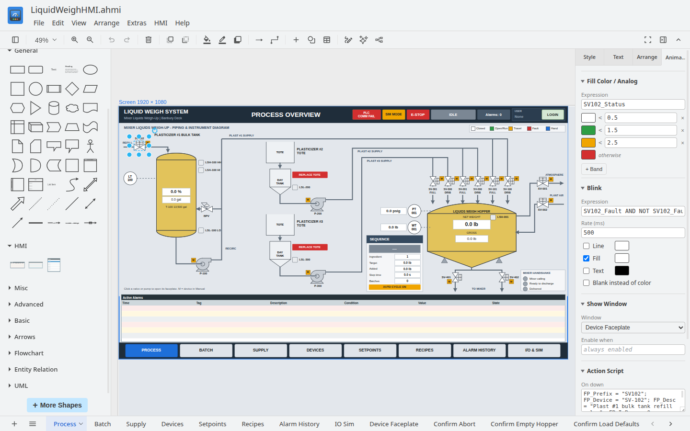

Append HMI Studio
=================

**Append HMI Studio** designs operator screens (HMIs) for PLCs, runs them against live equipment, and publishes them as Windows installers for the target PC.

**It is built for AI agents as well as people.** Give an agent the documents a project already has (the functional description or control narrative, the PLC program and the electrical drawings) and it can build a complete, good-looking and working HMI application, with very little intervention.



HMI applications built by AI agents
-----------------------------------

Most HMI packages can only be driven through their own screens, one dialog at a time. Append HMI Studio also has a complete command-line interface and documentation written for agents, so an AI agent such as Claude Code can do the whole job:

1. **Understand** the process from the functional description, the PLC program and the drawings.
2. **Describe** the application as a plain JSON spec: tags, devices, screens, objects, animation, alarms, users, recipes and scripts.
3. **Build and check** it (`--hmi-build`, `--hmi-check`). Errors and `PROBLEM` lines say exactly what to fix.
4. **Look at its own work** (`--hmi-render` draws every screen to PNG) and correct the layout.
5. **Change** existing projects without losing anything (`--hmi-dump`, including edits a person made in the Studio).
6. **Publish** the Windows installer (`--hmi-publish`).

**The LiquidWeighHMI example was written from scratch by an AI agent.** It was given three documents: a control narrative of a liquid weigh-up system, its I/O list, and its electrical drawings (a scanned PDF with no text layer, which the agent read as images). There was no PLC program either, so the agent wrote that first:
- 13 ControlLogix ladder routines, including a simulation of the process;
- tested with a static checker and a ladder simulator of its own, which found a real bug before the program reached a controller;
- along the way, it reported where the I/O list disagreed with the drawings.

It then built the HMI on the program's real tags. The application has 419 PLC tags, nine screens, a faceplate shared by 14 devices, alarms, users with access levels, recipes and trends. The engineer supplied the documents, reviewed the screens and asked for changes, mostly fine points of layout. The same agent later turned the PLC program into the application scripts of [LiquidWeighHMISim](examples/), which runs the whole process with no PLC at all.

**Documentation ready for agents.** Everything an agent needs is written down in a form it can use without guessing:

| Document | What it gives an agent |
|---|---|
| [.claude/skills/append-hmi-studio](.claude/skills/append-hmi-studio/SKILL.md) | A Claude Code skill: the workflow, the rules that matter, and good screen practice (palette, text sizes, navigation, alarms) |
| [doc/HMI_AUTOMATION.md](doc/HMI_AUTOMATION.md) | Every command and exit code, every field of the JSON spec, every object and animation link type, and the expression and script syntax |
| [HMI_ALARMS](doc/HMI_ALARMS.md), [HMI_SECURITY](doc/HMI_SECURITY.md), [HMI_RECIPES](doc/HMI_RECIPES.md), [HMI_INDIRECT](doc/HMI_INDIRECT.md) | How alarms, users, recipes and indirect tags behave, with their spec fields and script functions |
| [HMI_TRENDS](doc/HMI_TRENDS.md), [HMI_SQL](doc/HMI_SQL.md), [HMI_LISTS](doc/HMI_LISTS.md) | Trends and pens; databases, bind lists and the `SQL*` script functions; list boxes and the `List*` script functions |
| [HMI_WINDOWS](doc/HMI_WINDOWS.md) | Window types, the title bar and its look, movable popups, and window scripts |
| [HMI_TAG_REFERENCES](doc/HMI_TAG_REFERENCES.md) | Where tag names live, Find/Replace Tag References, and what a rename reaches |
| [HMI_QUICKFUNCTIONS](doc/HMI_QUICKFUNCTIONS.md) | Defining and calling QuickFunctions, and what a body may do |
| [example-spec.json](.claude/skills/append-hmi-studio/example-spec.json) | A complete small application to start from |

Anything an agent builds opens in the Studio like any other project, so a person can carry on by hand at any point. The [User Manual](doc/Append-HMI-Studio-User-Manual.pdf), section 1.1, covers this in more detail.

Features
--------

- **Design** screens on a diagram canvas, with tags, animation links, window properties and scripts.
- **Windows**: replace, overlay and modal popup windows, each showing its own part of its page, with an optional title bar whose height, font, text color and background are yours to set, and popups the operator can move by dragging that bar. See [doc/HMI_WINDOWS.md](doc/HMI_WINDOWS.md).
- **Run** them in the editor against real devices through the bundled comms server:
  - EtherNet/IP ControlLogix/CompactLogix;
  - SLC 5/05 and MicroLogix;
  - Modbus TCP;
  - a built-in simulator.
- **Alarms**: analog and discrete alarms with acknowledgement, the `_AlarmsActive`, `_AlarmsUnacked` and `_AckAll` system tags, Alarm List and Alarm History objects with colors of your own for each alarm state and event, and daily CSV history. See [doc/HMI_ALARMS.md](doc/HMI_ALARMS.md).
- **Scripts**: action and window scripts, plus application scripts that run On start, While running and On shutdown, with `DIM` local variables. They can carry a whole controller's logic, as in the LiquidWeighHMISim example.
- **Retentive memory tags** keep their last value from one run to the next.
- **Users and security**: users with access levels 0–9999, a built-in login window, the `_Username` and `_AccessLevel` system tags, login script functions, masked password entry and the Enable animation. See [doc/HMI_SECURITY.md](doc/HMI_SECURITY.md).
- **Indirect tags**: `IndirectDiscrete`, `IndirectAnalog` and `IndirectMessage` tags that a script points at any tag with `LinkIndirectTag("Indirect", "Tag")`, so one faceplate serves many devices. See [doc/HMI_INDIRECT.md](doc/HMI_INDIRECT.md).
- **Recipes**: recipe books of tag values with optional paired PLC tags, script functions to save, load, upload, download, export, import, delete, rename and select recipes, and a Recipe List object with colors of your own for its heading and selection. Recipes saved at run time are kept on the running PC. See [doc/HMI_RECIPES.md](doc/HMI_RECIPES.md).
- **Trends**: a Trend object with up to 8 analog or discrete pens, each on its own range, recorded from the start of the run with 7 days of history on disk. Scripts select the pen whose scale is shown, pause, scroll back and forward, and return to live. See [doc/HMI_TRENDS.md](doc/HMI_TRENDS.md).
- **List boxes**: a List Box object the operator picks from, filled by scripts with `ListAdd`, `ListLoad`, `ListRemove`, `ListSelect`, `ListSort` and `ListClear`, with its own selection colors and an optional title bar. The selection goes to a message tag. See [doc/HMI_LISTS.md](doc/HMI_LISTS.md).
- **Databases**: read and write Microsoft SQL Server and SQLite from scripts with the `SQL*` function family — data sources, bind lists that pair a tag with a column, table templates the application creates its tables from, saved queries, prepared statements with parameters, and transactions. Managed in HMI > Database. See [doc/HMI_SQL.md](doc/HMI_SQL.md).
- **Date and time system tags**: `_DateString`, `_TimeString`, `_DateTime`, `_Year`, `_Month`, `_Day`, `_Hour`, `_Minute`, `_Second` and `_Msec`, worked out as they are read, and a family of `String*` functions for building and picking apart text.
- **Windows and printing from scripts**: `ShowWindow(...)` opens a window, optionally moved, modeless or waited on; `ScreenToPDF()` saves the screen, popups included, as a landscape PDF through a Save dialog.
- **QuickFunctions**: name a piece of script logic once, with typed arguments and a `Return` value, and call it from scripts and from animation expressions. Managed in HMI > QuickFunctions. See [doc/HMI_QUICKFUNCTIONS.md](doc/HMI_QUICKFUNCTIONS.md).
- **Tag find and replace**: HMI > Find/Replace Tag References lists every tag the page or the selection names and re-points them in one undoable step, with a text replace across the names, a validate pass and a single-tag editor for creating what is missing. Renaming a tag in the Tag Dictionary now carries every reference in the project with it. See [doc/HMI_TAG_REFERENCES.md](doc/HMI_TAG_REFERENCES.md).
- **Drawing**: circle and ellipse arcs with start and end angles, line widths and arrowheads, and flipping that mirrors a whole group.
- **Automation and AI agents**: build, check, render and publish projects from the command line or a script, from a plain JSON spec; this is how AI agents build whole applications. See [doc/HMI_AUTOMATION.md](doc/HMI_AUTOMATION.md).
- **Publish** a project as a Windows installer (HMI > Publish). It installs a locked, run-only copy of the app with the comms server, built on any platform. See [doc/HMI_PUBLISH.md](doc/HMI_PUBLISH.md).

Projects are saved as `.ahmi` files. Files saved as `.drawio-hmi` by earlier builds still open.

Getting started
---------------

The [User Manual](doc/Append-HMI-Studio-User-Manual.pdf) ([Word](doc/Append-HMI-Studio-User-Manual.docx)) walks through building an application with screenshots, using the [LiquidWeighHMI example](examples/). In short:

1. **Tags:** in **HMI > Devices**, add your PLC (or use the simulator). Then define tags in **HMI > Tag Dictionary**.
2. **Screens:** draw them on the canvas. Each page is a window of the application.
3. **Animation:** select an object and add animation links on the **Animation** tab (colors, fill, movement, value display, touch actions).
4. **Test:** **HMI > Run** runs the project against live or simulated data.
5. **Deploy:** **HMI > Publish** builds a Windows installer for the target PC.

Documentation
-------------

| Topic | Document |
|---|---|
| Building HMI applications, step by step | [User Manual (PDF)](doc/Append-HMI-Studio-User-Manual.pdf) |
| Windows, title bars and movable popups | [doc/HMI_WINDOWS.md](doc/HMI_WINDOWS.md) |
| Alarms, system tags, alarm objects and history | [doc/HMI_ALARMS.md](doc/HMI_ALARMS.md) |
| Users, access levels and login | [doc/HMI_SECURITY.md](doc/HMI_SECURITY.md) |
| Recipe books, recipe functions and the Recipe List | [doc/HMI_RECIPES.md](doc/HMI_RECIPES.md) |
| Indirect tags and LinkIndirectTag | [doc/HMI_INDIRECT.md](doc/HMI_INDIRECT.md) |
| Trends, trend functions and the trend history | [doc/HMI_TRENDS.md](doc/HMI_TRENDS.md) |
| Databases, bind lists and the `SQL*` script functions | [doc/HMI_SQL.md](doc/HMI_SQL.md) |
| List boxes and the `List*` script functions | [doc/HMI_LISTS.md](doc/HMI_LISTS.md) |
| Finding and replacing tag references | [doc/HMI_TAG_REFERENCES.md](doc/HMI_TAG_REFERENCES.md) |
| QuickFunctions | [doc/HMI_QUICKFUNCTIONS.md](doc/HMI_QUICKFUNCTIONS.md) |
| Publishing a runtime installer | [doc/HMI_PUBLISH.md](doc/HMI_PUBLISH.md) |
| Command-line automation and the JSON project spec | [doc/HMI_AUTOMATION.md](doc/HMI_AUTOMATION.md) |
| The PLC comms server and its protocol | [comms/README.md](comms/README.md) |
| Building and packaging | [doc/BUILDING.md](doc/BUILDING.md) |
| Releases | [doc/RELEASE_PROCESS.md](doc/RELEASE_PROCESS.md) |

For AI agents, [.claude/skills/append-hmi-studio](.claude/skills/append-hmi-studio/SKILL.md) is a Claude Code skill that teaches the whole workflow, from the project documents to the published installer (see [HMI applications built by AI agents](#hmi-applications-built-by-ai-agents)).

Download
--------

Releases are published at [github.com/AppendAutomation/AppendHMIStudio/releases](https://github.com/AppendAutomation/AppendHMIStudio/releases):

- `Append-HMI-Studio-<version>-Setup.exe`
  - Windows 10/11 x64 installer, for all users (administrator rights).
  - Silent install: `/S`. Silent uninstall: `"C:\Program Files\Append HMI Studio\Uninstall.exe" /S`.
- `Append-HMI-Studio-<version>-x86_64.AppImage`: Linux, runs without installing.
- `Append-HMI-Studio-<version>-amd64.deb`: Debian and Ubuntu (`sudo apt install ./Append-HMI-Studio-*.deb`).

The installers are not code-signed yet, so Windows SmartScreen asks for confirmation on first run.

There is no automatic update: install a newer version over the old one.

Settings and logs are kept in `%APPDATA%\Append HMI Studio` (Windows) and `~/.config/Append HMI Studio` (Linux).

Security
--------

The app works offline. Diagram and project data never leave the machine, and the Content Security Policy forbids remotely loaded code. The only network traffic is what a project is configured to make: the PLCs it talks to, through the local `hmi-comms` server, and any database its data sources name. Nothing else is sent anywhere, and there is no telemetry.

A database connection is made by the main process, never by the screens, and a data source password is kept in the project only in an obfuscated form — which hides it and no more. A site that needs better can leave it out of the project and give each PC its own instead; see [doc/HMI_SQL.md](doc/HMI_SQL.md).

A diagram can still reference external media (an image or font by URL). That media is fetched when the diagram is opened, so the remote server sees the request, but no diagram content is sent.

Building
--------

See [doc/BUILDING.md](doc/BUILDING.md). In short, with Node.js 22.12+ and the .NET 8 SDK:

```
git clone --recursive https://github.com/AppendAutomation/AppendHMIStudio.git
cd AppendHMIStudio
npm install
npm start                 # run from source
npm run dist-win          # Windows installer (on Linux too, no wine)
npm run dist-linux        # AppImage and deb
```

The repository uses submodules; after a plain clone, run `git submodule update --init --recursive`.

| Path | Contents |
|---|---|
| `src/main/` | Electron main process: windows, IPC, run-only mode, Publish, alarm/retentive/user stores, database access |
| `drawio/` | Submodule: Append Automation's fork of the draw.io editor (branch `hmi`); the HMI code is in `src/main/webapp/js/hmi/` |
| `comms/` | `hmi-comms`, the .NET 8 PLC communications server, with the `cslogix` and `cscomm3_slc` submodules in `comms/lib/` |
| `scripts/` | Build scripts (`dist-win`, `dist-linux`, the Windows runtime template, icons, NSIS download) |
| `build/` | Icons, signing and fuse hooks |
| `src/test/` | Unit tests (`npm test`) |
| `doc/` | Documentation |

License and attribution
-----------------------

Append HMI Studio is © 2026 Append Automation and is licensed under the Apache License 2.0 (see [LICENSE](LICENSE)).

It is built on the [draw.io](https://github.com/jgraph/drawio) diagram editor and [drawio-desktop](https://github.com/jgraph/drawio-desktop) by JGraph Ltd, used and modified under the Apache License 2.0. [NOTICE](NOTICE) lists the third-party works and the changes made. Append HMI Studio is not affiliated with or endorsed by JGraph Ltd; "draw.io" is a trademark of its owner.
